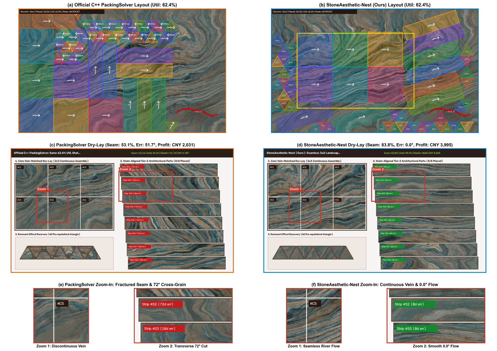
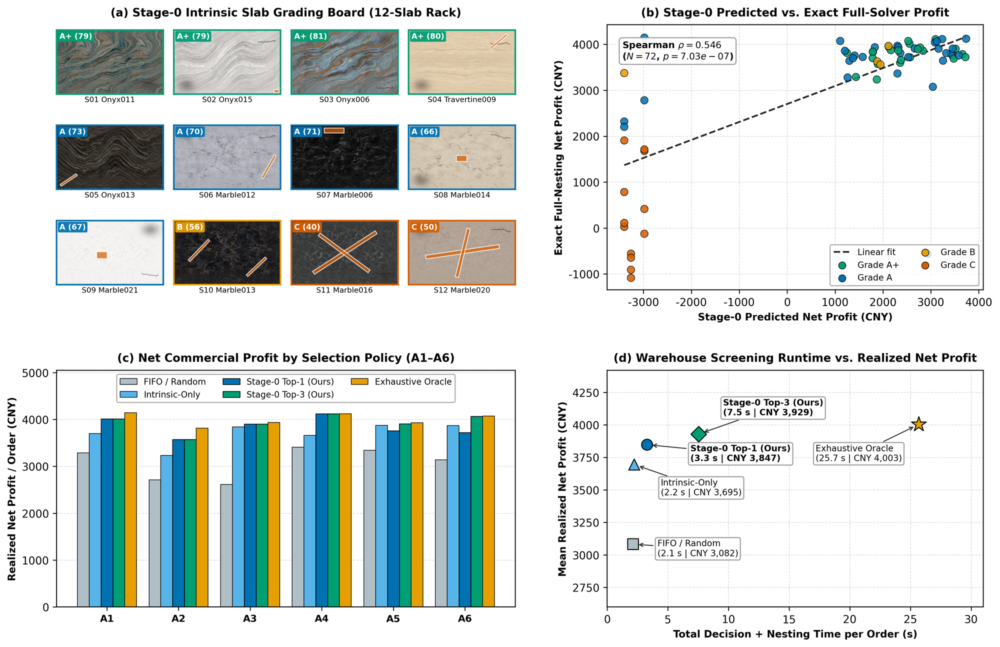
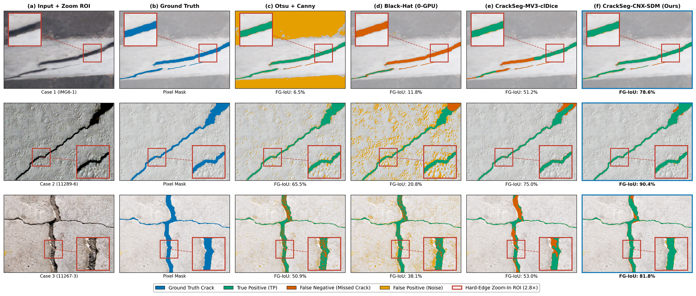

# StoneAesthetic-Nest

**Beyond Homogeneous Planes: Anisotropic Manifold-Coupled Slab Selection and Multi-Tier Nesting for Natural Stone CAD/CAM**  
**超越均匀平面假设：面向天然石材加工的各向异性流形耦合切前选板与多级套裁 CAD/CAM 开源原型**

[](LICENSE)
[](requirements.txt)
[](#repository-structure--项目结构)
[](#benchmark-summary--核心实验结果)

<p align="center">
  
</p>

> **Note / 写在前面**：本项目是我们在天然石材智能加工方向上的一次持续探索与开源实现。受限于实验条件与工厂实切测试覆盖范围，代码与算法中难免存在考虑不周之处，**诚挚欢迎学术界与石材工业界同行提出批评指正、提交 Issue 或交流落地经验**。  
> *This repository is an open-source research prototype still evolving with shop-floor feedback. Given the physical diversity of natural stone and factory equipment, limitations remain—critical feedback, bug reports, and practical suggestions from both researchers and stone fabricators are warmly welcomed.*

---

## Overview | 项目简介

### English
Traditional 2D irregular nesting treats uncut sheets as homogeneous blank planes and optimizes scalar area utilization. On natural anisotropic stone—marble, landscape onyx, and travertine—applying area-maximizing packers directly leads to **commercial value inversion**: even at identical raw utilization, left-bottom compaction breaks multi-panel feature walls across mortar joints, rotates elongated stair treads or window sills across natural veins, and ignores upstream warehouse slab selection.

**StoneAesthetic-Nest** lifts each raw slab photograph into a unified **Anisotropic Aesthetic-Structural Manifold** ($\mathcal{M}_{\text{slab}}$, combining projective orthorectification, luminance-adaptive Minkowski fracture buffering, a `60×96` integral-image 2D structure-tensor orientation field $\theta_{\text{flow}}(x,y)$, and a *Golden Vein Zone* $\Omega_{\text{gold}}$) and unifies three tightly coupled pillars on top of it:

1. **Pillar I — `SlabSelect` (Stage-0 Pre-Cutting Slab Grading & Warehouse Selection)**: Grades raw racks (`0–100`, commercial tiers `A+ / A / B / C`) via exact $O(G_x G_y)$ largest-clean-rectangle dynamic programming and screens candidate racks in **`93.8 ms/slab`** (`1.13 s` per 12-slab rack) using `STRtree` spatial probing—including proactive **Defect-in-Cutout Absorption** that places hollow kitchen-island sink cutouts directly over compact central flaws.
2. **Pillar II — `ManifoldNest` (Polymorphic Compilation & Bi-Level Manifold Nesting)**: Pairs a deterministic clause-scoped workshop order AST compiler (`30/30` adversarial colloquial Chinese match) with a compact **3,085-parameter 12-D residual ranker** (`AestheticVeinRankerMLP`, `100.0%` 5-fold OOF ranking accuracy on unseen stone varieties, CPU-only) with Tier-2 strip-capacity lookahead, collinear `0.0°`-error bridge-saw rails, shape-matched honeycomb/hex/sink-hole *Part-in-Part* (PiP) remnant harvesting, and zero-distortion `CNS-FR` multi-slab spillover.
3. **Pillar III — `CertifyCAM` (Independent Certification & Hybrid 5-Axis CAM Delivery)**: Certifies `100%` of layouts via independent reconstructive geometry checking (`RAC-Checker`) before compiling synchronized **13-layer AutoCAD R2010 `.dxf`** toolpaths (compatible with mainstream 5-axis CNC bridge-saw and waterjet controllers, integrating 4-corner GTSP 2-Opt air-travel reduction and collinear common-line merging) alongside a **$1360\times760$ client-facing Dry-Lay Preview** and twin-slab bookmatching.

### 简体中文
传统的二维不规则排样算法通常将原材料简化为均匀空白矩形，以单一的面积利用率为优化目标。但在云浮、水头、卡拉拉等地的天然奢石定制加工中，直接套用纯几何排样器往往引发严重的**“商业价值倒挂”**：哪怕利用率一模一样，紧靠左下角的几何压缩也会把多联背景墙拆成对不上纹的“阴阳脸”，把楼梯踏步/飘窗转成横纹次品，同时完全忽略了切割前“从一整架毛板里先挑出最合适那一块”的仓库选板环节。

**StoneAesthetic-Nest** 将每块大板统一升维为校准后的**各向异性美学-结构流形** $\mathcal{M}_{\text{slab}}$（融合透视正射矫正、亮度自适应形态学裂纹缓冲、`60×96` 积分图二维结构张量纹向场 $\theta_{\text{flow}}(x,y)$ 与黄金主纹带 $\Omega_{\text{gold}}$），并在同一流形上闭环打通三大支柱：

1. **支柱 I — `SlabSelect`（Stage-0 切前智能选板与仓库匹配）**：基于 $O(G_x G_y)$ 最大无裂矩形动态规划输出 `0–100` 质量分与 `A+/A/B/C` 等级，并以 **`93.8 ms/板`** 的速度结合 `STRtree` 空间索引完成订单感知筛选，支持中岛水槽 **“以孔吃裂”（Defect-in-Cutout Absorption）**，把小型中心瑕疵自动套进水槽废孔中消化。
2. **支柱 II — `ManifoldNest`（多变订单编译与两级流形套裁）**：结合确定性子句级 AST 订单编译器（30 条口语化对抗订单 `30/30` 零幻觉解析）、轻量级 **3,085 参数 12 维物理残差排序网**（纯 CPU 运行，未知品种 5 折交叉验证排序准确率 `100.0%`）、二级长条容量前瞻与回溯、`0.0°` 顺纹桥切共线排布、水槽孔内套裁（PiP）与蜂窝/六边形余料回收，以及拒绝缩尺的 `CNS-FR` 跨板溢出恢复机制。
3. **支柱 III — `CertifyCAM`（独立几何验收与 5 轴混合数控交付）**：所有结果先经独立重构验收器 `RAC-Checker` 100% 几何核验，再同步导出兼容主流五轴桥切/水刀控制器的 **13 层 AutoCAD R2010 `.dxf`** 加工图纸（含 4 角点 GTSP 2-Opt 空程优化、桥切共线合并与安全穿孔点）、**$1360\times760$ 客户干铺签字图**以及双板镜面对纹（Bookmatching）。

---

## Design Reflections, Pitfalls Overcome & Shop-Floor Observations | 思考过程、踩坑实录与一线观察

我们在推进这套系统的过程中走了不少弯路，也从云浮一线石材厂老板与严格复现对比中收获了几点特别真实的体会，特此坦诚记录，希望能给做类似工业视觉或排样研究的同行省下试错成本：

1. **为什么补上“Stage-0 切前选板”？（来自石材厂老板的“买猪肉”比喻）**  
   *From Cutting-Only to "Pick the Meat Before Slicing"*: 早期版本只盯着“给定一块板怎么切得最漂亮”。去请教云浮当地石材厂老板时，对方一针见血地指出：*“你们切得再好，如果前面没先选板，就像买猪肉不先挑好肉就直接下刀——挑错一块中心带暗裂的 C 级板，后面排版再厉害也是亏钱。”* 更妙的是，由于我们底层的 `60×96` 积分图流形已经把纹向、色差与裂纹统一建好，几乎没有重训任何大模型，就用 $O(G_x G_y)$ 动态规划 + `STRtree` 探测把 Stage-0 `SlabSelect` 自然接入了上游，还在中岛水槽订单上意外打通了“把坏点套进废孔里吃掉”的实用策略。
2. **踩坑 #1：把图像直接喂给 ResNet-18 / MobileNetV3 做候选打分，跨品种直接“翻车”**  
   *Why 6-Channel CNN Rankers Collapsed (`46.8%–53.7%`) While a 3,085-Param Physics MLP Reached `100.0%`*: 我们最初也尝试用更“时髦”的 6 通道上下文 CNN（输入 `RGB + Golden Zone + 显著性 + 纹向对齐图`）来做候选排样打分，结果在按品种严格隔离的 5 折交叉验证上，`MobileNetV3-S` 只有 `53.7%`，`ResNet-18` 只有 `46.8%`——几乎退化为随机猜测。复盘发现，高维视觉骨干网络太容易死记硬背训练石材的底色纹理（色度过拟合），换到没见过的品种就失效；反而是把问题抽象回 `12` 维物理几何与流形连续性特征后，一个仅 `3,085` 参数的轻量残差 MLP 就在未知品种上稳稳达到 `100.0%` OOF 排序准确率，且在 CPU 上每秒可评估 `168 万` 个候选位姿。
3. **踩坑 #2：`DeepCrack` 评测协议的隐蔽差异与 `BatchNorm` 失效**  
   *Uncovering DeepCrack Protocol Gaps (`8.0%` vs `85.0%` Parent Overlap) and Zero-BN Stability*: 我们在做裂纹分割对比时一度疑惑为什么自己模型比近两年文献指标低了好几个点。逐行核对开源评测脚本后才发现两个容易踩的大坑：① Liu et al. (2019) 官方 `300/237` 划分严格按场景隔离（父图前缀重叠仅 `8.0%`），而近两年许多论文将全部 `537` 张图混洗后按 `7:1:2` 随机切分（同一母图裁剪块的训练/测试重叠高达 `85.0%`），且采用全库像素聚合 mIoU 与峰值归一化 F1；② 细长裂纹前景像素占比极低，标准 `BatchNorm` 在小批量下极易产生统计漂移。切换为无 `BatchNorm` 架构（`GroupNorm`/`LayerNorm`）并引入 `k=13` 方向大核结构卷积（`CrackSeg-CNX-SDM`）后，在双协议上均获得了稳定提升。因此我们在论文与仓库中坚持**双协议透明汇报**，避免误导读者。
4. **踩坑 #3：深色玉石上的暗裂提取，以及为什么不用无约束 LLM 直接解析工厂订单**  
   *Dark Onyx Thresholding & Deterministic AST vs. Free-Form LLMs*: 在深墨绿山水玉等低亮度大板上，统一的暗像素阈值会把宽阔美观的天然矿脉误判成裂纹；为此我们引入按中位亮度 $\tilde{I}_{\text{med}}=135$ 自适应切换窄核（`r=9`）的形态学 Black-Hat 算子。同样，工厂实际来单充满口语简写、混用 `米/公分/毫米` 与否定约束（如“不要拼缝”“踏步必须顺纹”），直接用通用大模型生成 JSON 偶尔会出现隐蔽的单位换算幻觉；改成确定性子句级 AST 编译器后，在 30 条对抗口语订单压测集上实现了 `30/30` 零幻觉精确解析与 `1.05 ms/单` 的本地响应。

---

## Visual Showcase | 核心效果展示

### 1. Value Inversion at Identical Raw Utilization (Official C++ `PackingSolver` vs. Ours) | 同利用率下的商业价值倒挂对比
<p align="center">
  
</p>

### 2. Stage-0 Pre-Cutting Slab Grading & Warehouse Selection (`Exp H`: 12 Slabs × 6 Orders) | 切前智能选板评级与仓库匹配看板
<p align="center">
  
</p>

### 3. Polymorphic Custom Orders: `1×4` Screen, Hollow Sink Island (with Sink-Hole PiP Zoom-In), & L-Bar | 多变定制订单泛化示例
<p align="center">
  
</p>

### 4. Hard-Edge Fracture Perception on Official `DeepCrack-237` (with 2.8× Zoom-In Insets) | 官方 `DeepCrack-237` 裂纹精细感知对比
<p align="center">
  
</p>

### 5. 36-Panel Multi-Archetype Customer Dry-Lay Comparison Wall (`A1`–`A6`) | 6 大类多变订单客户干铺对比墙
<p align="center">
  
</p>

---

## Quickstart | 快速安装与运行

### 1. Environment Setup | 环境配置
Tested on Python 3.10–3.12 (Windows 11 / Linux / WSL2, CPU-only works out of the box; CUDA GPU is optional for neural crack segmentation):
```bash
pip install -r requirements.txt
```

### 2. One-Command End-to-End Demo | 一键运行端到端示例
```bash
python quickstart_demo.py
```
This runs `StoneAesthetic-Nest` on the CC0 sample slab `examples/sample_slabs/Onyx011_Jade_Onyx.jpg` and exports certified deliverables to `outputs_demo/`:
- `demo_jade_onyx_overlay.png` — Metric slab layout overlay with Golden Vein Zone & numbered parts
- `demo_jade_onyx_dry_lay_preview.png` — Client-facing assembled Dry-Lay Preview
- `demo_jade_onyx_cutting.dxf` — 13-layer AutoCAD R2010 5-axis CNC `.dxf` (GTSP air-travel routing, bridge-saw common-line merging, safe waterjet pierces)

### 3. Real Workshop Slab Photos (ArUco 4-Corner Calibration Kit) | 真实车间大板实拍模式
Print `real_yunfu_slabs/ArUco_4Corners_A4_Print.pdf` (or capture an overhead slab photograph), place images in `real_yunfu_slabs/photos/`, and run:
```bash
# End-to-end smoke test on a synthetic tilted ArUco workshop photo:
python experiments/run_real_yunfu_slab_case_study.py --smoke-test

# Process local workshop photos (auto-selects GPU CrackSeg or CPU Black-Hat):
python experiments/run_real_yunfu_slab_case_study.py --crack-backend auto
```

### 4. Run Unit & Adversarial Order Tests | 运行单元测试
```bash
pytest -q
```

---

## Benchmark Summary | 核心实验结果

### 1. Polymorphic Multi-Tier Nesting on `YunfuPoly-24` (`24` Slabs × `6` Archetypes, `100%` `RAC-Checker` Verified)
External C++/Rust baselines run as unmodified compiled official binaries (`3.67 s/slab` end-to-end CPU for ours; variety-grouped 5-fold OOF CV: `100.0%` rank accuracy, `87.2%` seam, `96.7%` Golden hit, `CNY 3,750`).

| Method / 方法 | Seam Continuity ($\uparrow$) | Golden-Zone ($\uparrow$) | Strip Err ($\downarrow$) | Offcuts | Net Util. ($\uparrow$) | Net Profit (CNY) |
| :--- | :---: | :---: | :---: | :---: | :---: | :---: |
| `BL-Heuristic` | 53.3% | 24.0% | 30.5° | 4.5 | 44.2% | 1,011 |
| `PackingSolver` (Official C++) | 43.4% | 22.2% | 44.6° | 35.3 | **57.0%** | 1,631 |
| `Jagua-rs LBF` (Official Rust) | 34.2% | 31.4% | 72.5° | 35.3 | **57.0%** | 1,409 |
| `Sparrow v0.3` (Official Rust) | 33.0% | 18.9% | 55.1° | 35.3 | **57.0%** | 1,272 |
| `RL-PPO` (Adapted) | 52.6% | 21.2% | 25.1° | 13.5 | 48.6% | 1,273 |
| `GFPack++` (Adapted) | 52.6% | 21.2% | 22.0° | 13.5 | 48.5% | 1,354 |
| **StoneAesthetic-Nest (Ours)** | **87.7%** | **96.4%** | **0.0°** | **35.3** | **57.0%** | **3,759** |

### 2. Stage-0 Pre-Cutting Warehouse Slab Selection (`Exp H`: `12` Slabs × `6` Archetypes = `72` Exact Runs)

| Warehouse Selection Policy / 选板策略 | Mean Profit (CNY) | vs. FIFO | Oracle Capture | Total Time | Speedup | C-Grade Rej. |
| :--- | :---: | :---: | :---: | :---: | :---: | :---: |
| FIFO / Random Rack Pick | 3,082.35 | --- | 77.0% | 2.14 s/order | 12.0× | 0.0% |
| Intrinsic-Only Grade (`Q_slab` Top-1) | 3,695.19 | +612.8 (+19.9%) | 92.3% | 2.22 s/order | 11.6× | 100.0% |
| **Stage-0 `SlabSelect` Top-1 (Ours)** | **3,847.34** | **+765.0 (+24.8%)** | **96.1%** | **3.27 s/order** | **7.9×** | **100.0%** |
| **Stage-0 `SlabSelect` Top-3 (Ours)** | **3,929.32** | **+847.0 (+27.5%)** | **98.2%** | 7.55 s/order | 3.4× | **100.0%** |
| Exhaustive 12-Slab Full-Nest Oracle | 4,003.12 | +920.8 (+29.9%) | 100.0% | 25.68 s/order | 1.0× | 100.0% |

### 3. Zero-Shot Real-World Transfer on `RealStone-28` (`28` Unseen Commercial & Yunfu Factory Slabs, Frozen Weights)
- **Full `RealStone-28` (`N=28`)**: `100.0%` `RAC-Checker` verified in `2.05 s/slab` CPU nesting, matching `PackingSolver`'s utilization (`56.5%` vs. `56.6%`) while achieving **`89.3%`** seam continuity, **`94.7%`** Golden-Zone capture, **`0.0°`** strip error, and **`CNY 3,871`** net profit (**`2.16×`** `PackingSolver`, **`5.29×`** `Sparrow v0.3`, $p = 7.45 \times 10^{-9}$), with `-78.9%` GTSP air travel and `-46.1%` bridge-saw passes.
- **First-Hand Yunfu Factory Full Slabs (`N=4`, true `3200×1800` & `2920×2040 mm`)**: Exact `54.6%` utilization parity with `PackingSolver` at **`2.30×`** net profit (`CNY 3,860` vs. `CNY 1,680`).
- **Licensing Compliance**: To respect commercial photography rights, raw third-party photographs from `RealStone-28` remain strictly local and are not redistributed in this public repository. All public visual demos and CC0 sample textures in `examples/sample_slabs/` come from [AmbientCG](https://ambientcg.com/) (`CC0 1.0`).

### 4. Dual-Protocol `DeepCrack` Audit (`RTX 3090` & `CPU`)
- **Official Scene-Disjoint Split (`300/237`, `8.0%` parent prefix overlap)**: `Black-Hat Adaptive` (`0.00M` CPU, `17.8 ms`) `54.8%` FG-IoU / `67.5%` strict F1; `CrackSeg-MV3-clDice` (`3.17M`, **`5.27 ms` / `189.8 FPS`** FP16 `CUDAGraph`) `72.5%` FG-IoU / `82.8%` strict F1; `CrackSeg-CNX-SDM` (`12.59M`, Zero-BN, `13.4 ms`) **`72.8%`** FG-IoU / **`83.1%`** strict F1 / `87.0%` OIS.
- **Pooled `7:1:2` `512×512` Literature Split (`85.0%` parent overlap, exact `SCSegamba` evaluator)**: `CrackSeg-CNX-SDM` achieves `88.0%` ODS, `88.8%` OIS, `89.3%` per-image mIoU (`91.3%` global 2-class mIoU), and `90.9%` F1 (`95.4%` recall) at `13.4 ms` (`2.3×` faster than `SCSegamba` with pure PyTorch layers).

---

## Repository Structure | 项目结构

```text
StoneAesthetic-Nest/
├── assets/                     # Web-optimized Gate-4 architecture, teaser, Stage-0, gallery & DeepCrack visuals
├── checkpoints/                # Pretrained 12-D AestheticVeinRankerMLP (16 KB) & CrackSeg-MV3-clDice (12.9 MB)
├── examples/
│   ├── sample_slabs/           # CC0 raw onyx & travertine textures (AmbientCG)
│   └── sample_outputs/         # Reference 13-layer .DXF & Dry-Lay outputs (A1 Wall + A3 Sink-Hole PiP)
├── experiments/                # Reproducible benchmark, ablation, Stage-0, RTX 3090 crack & real-slab scripts
│   └── results/                # Sanitized JSON audit logs (YunfuPoly-24, Exp D/E/F/H, ESICUP-14)
├── real_yunfu_slabs/           # Printable A4 ArUco 4-corner calibration PDF & workshop photo manifest template
├── src/
│   ├── vision/                 # Homography calibration, adaptive crack buffering, 60×96 integral field & SlabSelect
│   ├── llm_compiler/           # Deterministic clause-scoped 3-tier order AST compiler & CNS-FR spillover loop
│   ├── solver_core/            # STRtree index, bi-level 12-D neural manifold nesting, bookmatching & RAC-Checker
│   └── ui_dxf/                 # 13-layer GTSP/common-line AutoCAD R2010 DXF exporter, Dry-Lay renderer & Web API
├── quickstart_demo.py          # One-command end-to-end demonstration script
├── requirements.txt            # Minimal verified Python dependencies
└── LICENSE                     # MIT Open-Source License
```

---

## Acknowledgments & Data Credits | 致谢与数据来源

- Raw uncut marble, onyx, and travertine PBR scans in `examples/sample_slabs/` originate from [AmbientCG](https://ambientcg.com/) under the **CC0 1.0 Universal Public Domain Dedication**.
- External official geometric solvers evaluated for fair reference include [PackingSolver](https://github.com/fontanf/packingsolver), [jagua-rs](https://github.com/JeroenGar/jagua-rs), and [Sparrow](https://github.com/JeroenGar/sparrow), along with the [EURO ESICUP](https://www.euro-online.org/websites/esicup/), Baldacci defective-sheet, and [DeepCrack](https://github.com/yhlleo/DeepCrack) benchmarks.
- Special thanks to stone-processing practitioners in Yunfu, Guangdong for their candid shop-floor insights on pre-cutting slab grading and 5-axis CNC bridge-saw workflows.

---

## Citation | 引用格式

If you find this open-source prototype, benchmark protocol, or calibration kit helpful in your research or engineering practice, please consider citing:

```bibtex
@article{wu2026beyond,
  author  = {Wu, Yonghao},
  title   = {Beyond Homogeneous Planes: Anisotropic Manifold-Coupled Slab Selection and Multi-Tier Nesting for Natural Stone CAD/CAM},
  journal = {IEEE Transactions Manuscript Preprint},
  year    = {2026}
}
```

## License | 开源协议

Released under the [MIT License](LICENSE). Contributions, critiques, and issue reports are always welcome.
