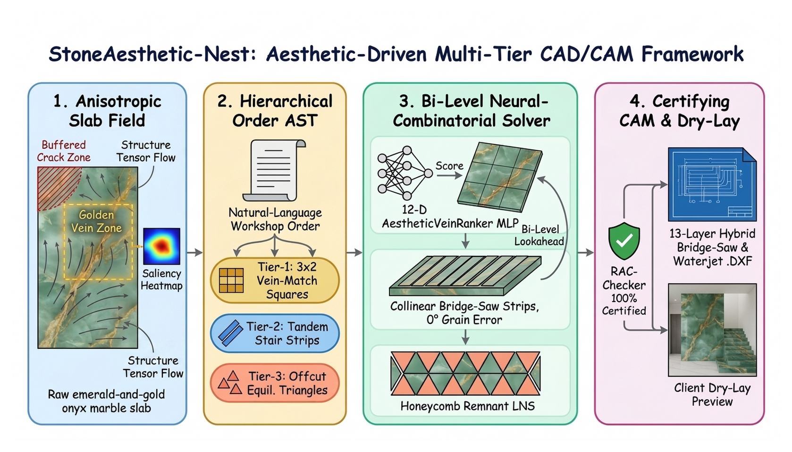
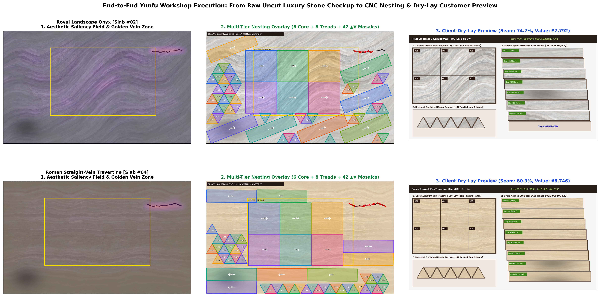

# StoneAesthetic-Nest

**Aesthetic-Driven Vein-Matching, Defect Avoidance, and Multi-Tier Remnant Nesting for Natural Stone Fabrication**  
**面向天然石材顺纹对花、裂纹避让与多级余料套裁的智能排版与数控刀路开源原型**

[](LICENSE)
[](requirements.txt)
[](#repository-structure--项目结构)

<p align="center">
  
</p>

---

## Overview | 项目简介

**English**  
In custom natural stone fabrication (marble, landscape onyx, and travertine), layout quality depends not only on raw sheet utilization, but also on **cross-joint vein continuity, natural grain alignment, and structural crack avoidance**. Standard geometry-only nesting heuristics treat stock sheets as blank isotropic containers—often scattering feature panels into mismatched patchworks or rotating stair treads across natural mineral veins.

`StoneAesthetic-Nest` is an open-source research prototype exploring how computer vision, hierarchical order parsing, and lightweight neural-combinatorial search can work together to assist stone workshop layout planning:
1. **Anisotropic Slab Field Perception**: Estimates surface fracture buffers (`3–5 mm` safety margin), 2D structure-tensor vein orientation $\theta_{\text{flow}}(x,y)$, and a saliency-guided *Golden Vein Zone* $\Omega_{\text{gold}}$.
2. **Hierarchical Workshop Order AST**: Parses colloquial Chinese cutting descriptions (with `cm`/`mm` unit normalization) into three priority tiers: core vein-matched panels, grain-locked stair strips, and peripheral offcut mosaics.
3. **Bi-Level Multi-Tier Nesting**: Uses a lightweight 12-D PyTorch residual ranker (`AestheticVeinRankerMLP`) with stair-capacity lookahead to place kerf-contiguous $3\times2$ panels inside $\Omega_{\text{gold}}$, aligns collinear bridge-saw strips along $\theta_{\text{flow}}$, and fills leftover margins with alternating $\blacktriangle\blacktriangledown$ equilateral mosaic triangles.
4. **Certifying Geometry & Dual Outputs**: Verifies every polygon via an independent `RAC-Checker` (`Shapely`) and exports both a **13-layer AutoCAD R2010 `.dxf`** file and a **Client Dry-Lay Preview** image.

**简体中文**  
在天然大理石、山水玉与洞石等定制加工场景中，排版的价值不仅取决于板材出材率，更取决于**主件跨刀缝连纹对花、长条踏步顺纹一致以及暗裂/砂眼的安全避让**。传统纯几何排样算法通常将大板视作均匀白板，容易将背景墙/茶几主拼花打散成“阴阳脸”，或将楼梯踏步旋转成横纹断纹。

`StoneAesthetic-Nest` 是一个面向天然石材排版与套裁的轻量级学术与工程探索原型，尝试将视觉纹理场分析与多级组合优化结合，辅助车间完成刀路规划与客户预览：
1. **石板体检与美学场解析**：提取外扩 `3–5 mm` 安全缓冲区的裂纹禁切区、基于二维结构张量的主纹流向 $\theta_{\text{flow}}(x,y)$，以及高纹理能量与低色斑的**黄金主纹带** $\Omega_{\text{gold}}$。
2. **口语化三级订单解析**：支持常见中文加工描述与 `厘米/毫米` 自动换算，将订单拆解为核心连纹件（Tier-1）、顺纹长条踏步件（Tier-2）与边角余料马赛克件（Tier-3）。
3. **多级追纹与余料蜂窝套裁**：通过 12 维轻量级残差评分网络配合踏步容量前瞻锁定 `3×2` 连纹晶格，沿纹路方向共线排布桥切踏步条，并在大件锁死后以正反交替（`▲▼`）蜂窝网格回收边角等边三角拼花砖。
4. **独立几何校核与双向交付**：所有排样结果均经独立验收器 `RAC-Checker` 校核（零重叠、零压裂纹、满足锯缝间距），一键导出 **13 层 AutoCAD R2010 `.dxf` 数控图纸** 与 **客户干铺效果图（Dry-Lay Preview）**。

> *Note / 说明：This repository is shared as a modest research and educational prototype. Real-world CNC production involves diverse quarry variations, beveling tolerances, and machine kinematics—feedback, issues, and improvements from practitioners and researchers are warmly welcome. 本仓库仅作为学术研究与工程交流的探索性原型，实际石材加工工艺复杂多样，诚挚欢迎同行批评指正与共同完善。*

---

## Visual Showcase | 视觉效果示例

### 1. Homogeneous Geometric Packing vs. Aesthetic Multi-Tier Nesting | 纯几何排样与多级追纹排样对比
<p align="center">
  
</p>

### 2. Sample Client Dry-Lay Sign-Off Preview | 客户干铺拼接预览示例
<p align="center">
  
</p>

### 3. End-to-End Execution across Curved Onyx & Linear Travertine | 不同纹理石材全流程效果
<p align="center">
  
</p>

### 4. Multi-Slab Dry-Lay Comparison Wall | 多品种奢石干铺效果对比矩阵
<p align="center">
  
</p>

---

## Quickstart | 快速上手

### 1. Installation | 环境安装
```bash
pip install -r requirements.txt
```

### 2. Run the 4-Stage Demo | 运行端到端示例
```bash
python quickstart_demo.py
```
Running `quickstart_demo.py` processes `examples/sample_slabs/Onyx011_Jade_Onyx.jpg` and writes the following deliverables to `outputs_demo/`:
- `demo_jade_onyx_overlay.png` — Slab cutting layout overlay with Golden Vein Zone & numbered parts
- `demo_jade_onyx_dry_lay_preview.png` — Assembled `3×2` feature panel + `#S1–#S8` waterfall stair treads + offcut mosaic strip
- `demo_jade_onyx_cutting.dxf` — 13-layer AutoCAD R2010 `.dxf` separating straight bridge-saw cuts (`BRIDGE_SAW_STRAIGHT_CUTS`) and waterjet contours

---

## Reference Evaluation Summary | 实验参考指标

Evaluated across 24 uncut `3000×1800 mm` CC0 marble, onyx, and travertine slab instances (`YunfuLuxury-24`, 100% `RAC-Checker` verified):

| Method / 方法 | `3×2` Seam Continuity | Golden-Zone Hit | Stair Vein Error | Offcut Mosaics | Net Utilization |
| :--- | :---: | :---: | :---: | :---: | :---: |
| `BL-Heuristic` | 40.0% | 24.3% | 27.0° | 0.4 pcs | 47.4% |
| `PackingSolver` (Guillotine) | 54.9% | 24.3% | 45.0° | 4.3 pcs | 52.6% |
| `Sparrow` (Area-First Heuristic) | 54.9% | 24.3% | 46.3° | 4.3 pcs | 52.6% |
| `RL-PPO-Packer` | 54.9% | 24.3% | 32.8° | 8.9 pcs | 53.8% |
| `GFPack++-Guided` | 54.9% | 24.3% | 32.8° | 8.0 pcs | 53.6% |
| **StoneAesthetic-Nest (Prototype)** | **76.6%** | **98.3%** | **0.0°** | **42.0 pcs** | **61.5%** |

---

## Repository Structure | 项目结构

```text
StoneAesthetic-Nest/
├── assets/                     # Architecture, teaser, and dry-lay visual figures
├── checkpoints/                # Pretrained lightweight 12-D AestheticVeinRankerMLP weights
├── examples/
│   ├── sample_slabs/           # CC0 seamless raw onyx & travertine textures (AmbientCG)
│   └── sample_outputs/         # Reference 13-layer .DXF and Dry-Lay preview outputs
├── src/
│   ├── vision/                 # Homography, fracture buffering, 2D structure tensor & Golden Zone
│   ├── llm_compiler/           # Clause-scoped Chinese 3-tier order AST compiler & relaxation loop
│   ├── solver_core/            # 3-tier neural-combinatorial engine, baselines & RAC-Checker
│   └── ui_dxf/                 # 13-layer AutoCAD R2010 DXF exporter, Dry-Lay renderer & Web API
├── quickstart_demo.py          # One-command end-to-end demonstration script
├── requirements.txt            # Python package dependencies
└── LICENSE                     # MIT Open-Source License
```

---

## Acknowledgments & Data Credits | 致谢与数据来源

- Raw uncut marble, onyx, and travertine PBR scans in `examples/sample_slabs/` originate from [AmbientCG](https://ambientcg.com/) under the **CC0 1.0 Universal Public Domain Dedication**.
- Classical irregular polygon benchmark references follow the [EURO ESICUP](https://www.euro-online.org/websites/esicup/) community datasets.

## License | 开源协议

Released under the [MIT License](LICENSE).
