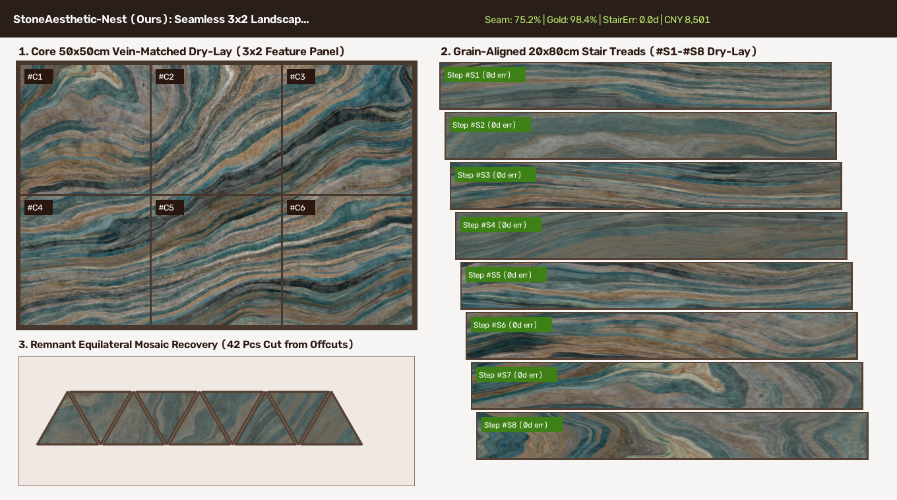
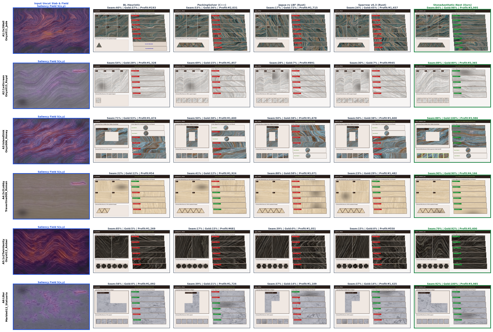

# StoneAesthetic-Nest

**Aesthetic-Driven Vein-Matching, Defect Avoidance, and Multi-Tier Remnant Nesting for Natural Stone Fabrication**  
**面向天然石材多变定制订单的顺纹对花、裂纹避让与多级余料套裁开源原型**

[](LICENSE)
[](requirements.txt)
[](#repository-structure--项目结构)

<p align="center">
  
</p>

---

## Overview | 项目简介

**English**  
In custom natural stone fabrication (marble, landscape onyx, and travertine), layout quality depends not only on raw sheet utilization, but also on **cross-joint vein continuity, natural grain alignment, structural crack avoidance, and interior cutout reuse**. Even full-strength geometric packing engines treat stock sheets as blank isotropic containers—often scattering multi-panel feature walls into mismatched patchworks or rotating elongated strips across natural mineral veins at identical raw area utilization.

`StoneAesthetic-Nest` is an open-source research prototype exploring how anisotropic visual fields, polymorphic order compilation, and lightweight neural-combinatorial search can work together to assist natural stone CAD/CAM workflows:
1. **Anisotropic Slab Field Perception**: Estimates surface fracture buffers (`3–5 mm` safety margin), 2D structure-tensor vein orientation $\theta_{\text{flow}}(x,y)$, and a saliency-guided *Golden Vein Zone* $\Omega_{\text{gold}}$.
2. **Polymorphic 3-Tier Workshop Order AST**: Parses flexible natural-language cutting descriptions (`cm`/`mm` unit normalization) across diverse real-world order archetypes: arbitrary $R\times C$ vein-matched grids (`3×2` feature walls, `1×4` landscape screens, `2×2` lobby medallions, `1×2` twin vanities), monolithic hollow sink islands, L-shaped corner bars, circular coffee tables, grain-locked strips (stair treads, window sills, thresholds, dado strips), and triangle/hexagon/square offcuts.
3. **Bi-Level Neural-Combinatorial Nesting & Sink-Hole PiP**: Uses a compact 12-D PyTorch residual ranker (`AestheticVeinRankerMLP`, `3,085` parameters) with Tier-2 capacity lookahead to anchor core assemblies inside $\Omega_{\text{gold}}$, aligns collinear bridge-saw strips strictly along $\theta_{\text{flow}}$ (`0.0°` error), harvests interior kitchen-island sink cutouts via *Part-in-Part* (PiP) reuse, and tessellates peripheral remnants using alternating `▲▼` equilateral honeycombs, 2D hexagonal lattices, or square grids.
4. **Certifying Geometry & Dual Deliverables**: Verifies every polygon via an independent `RAC-Checker` (`Shapely`) and exports both a **13-layer AutoCAD R2010 `.dxf`** toolpath file and a **Client Dry-Lay Preview** image.

**简体中文**  
在天然大理石、山水玉与洞石等定制加工场景中，排版的商业价值不仅取决于板材出材率，更取决于**核心件跨刀缝连纹对花、长条件顺纹一致、暗裂安全避让以及挖孔余料二次套裁**。即便是最顶尖的纯几何排样求解器，由于默认将大板视为均匀白板，往往在相同利用率下将多联背景墙打散成“阴阳脸”，或将踏步/飘窗旋转成横纹废品。

`StoneAesthetic-Nest` 是一个面向天然石材排版与套裁的轻量级学术与工程探索原型，尝试将视觉纹理场分析、多变订单解析与多级组合优化结合，辅助车间完成数控刀路规划与客户干铺确认：
1. **石板体检与美学场解析**：提取外扩 `3–5 mm` 安全缓冲区的裂纹禁切区、二维结构张量主纹流向 $\theta_{\text{flow}}(x,y)$，以及高纹理能量与低色斑的**黄金主纹带** $\Omega_{\text{gold}}$。
2. **多变定制订单三维解析**：支持口语化中文描述与 `厘米/毫米` 自动换算，灵活适配 6 大类常见定制订单：任意 $R\times C$ 连纹拼花（`3×2` 背景墙、`1×4` 四联屏、`2×2` 大堂田字格、`1×2` 双联洗手台）、中岛挖孔台面、L 形转角吧台、圆形茶几、顺纹长条（楼梯踏步/飘窗/门槛/护墙板）以及等边三角形、正六边形或方形余料砖。
3. **多级追纹与孔内/边角余料套裁**：通过 12 维轻量级残差评分网络配合容量前瞻锁定核心大件，沿主纹方向共线排布 `0.0°` 误差桥切长条，并在主件锁死后同步完成**水槽内孔 Part-in-Part 孔内套裁**以及外围 `▲▼` 蜂窝三角 / 正六边形 / 方砖余料密铺。
4. **独立几何校核与双向交付**：所有排样结果均经独立验收器 `RAC-Checker` 校核（零重叠、零压裂纹、严格满足锯缝间距），一键导出 **13 层 AutoCAD R2010 `.dxf` 数控图纸** 与 **客户干铺效果图（Dry-Lay Preview）**。

> *Note / 说明：This repository is shared as a modest research and educational prototype. Real-world CNC stone production involves diverse quarry variations, beveling tolerances, and machine kinematics—feedback, issues, and improvements from practitioners and researchers are warmly welcome. 本仓库仅作为学术研究与工程交流的探索性原型，实际石材加工工艺复杂多样，诚挚欢迎同行批评指正与共同完善。*

---

## Visual Showcase | 视觉效果示例

### 1. Value Inversion at Identical Raw Utilization (Official C++ `PackingSolver` vs. Ours) | 同利用率下的价值倒挂对比
<p align="center">
  
</p>

### 2. Polymorphic Custom Orders: `1×4` Screen + Hexagons, Hollow Sink Island + Sink-Hole PiP Coasters, & L-Bar | 多变定制订单泛化示例
<p align="center">
  
</p>

### 3. Sample Client Dry-Lay Sign-Off Preview (`A1` Feature Wall & `A3` Hollow Sink Island PiP) | 客户干铺预览示例
<p align="center">
  
</p>

### 4. 36-Panel Multi-Archetype Dry-Lay Comparison Wall (`A1`–`A6`) | 6 大类多变订单干铺效果对比墙
<p align="center">
  
</p>

---

## Quickstart | 快速上手

### 1. Installation | 环境安装
```bash
pip install -r requirements.txt
```

### 2. Run the 4-Stage Demo | 运行端到端示例
```bash
python quickstart_demo.py
```
Running `quickstart_demo.py` processes `examples/sample_slabs/Onyx011_Jade_Onyx.jpg` and writes the following deliverables to `outputs_demo/`:
- `demo_jade_onyx_overlay.png` — Slab cutting layout overlay with Golden Vein Zone & numbered parts
- `demo_jade_onyx_dry_lay_preview.png` — Assembled feature panel + directional strips + offcut mosaic strip
- `demo_jade_onyx_cutting.dxf` — 13-layer AutoCAD R2010 `.dxf` separating straight bridge-saw cuts (`BRIDGE_SAW_STRAIGHT_CUTS`) and waterjet contours

---

## Reference Evaluation Summary | 实验参考指标

Evaluated across `YunfuPoly-24` (`24` uncut `3000×1800 mm` CC0 marble, onyx, and travertine slabs spanning `6` polymorphic architectural order archetypes `A1`–`A6`, 100% `RAC-Checker` verified, `1.92 s/slab` CPU). External C++ and Rust baselines execute unmodified official compiled binaries (`EURO/ESICUP-14` native strip density: `70.4%` for `Jagua-rs LBF`, `79.4%` at `2 s` and `84.0%` at `60 s` for Official Rust `Sparrow v0.3`; `Baldacci-6` defective Bin-0 utilization: `70.4%` for Official C++ `PackingSolver`, `65.9%` for our geometric core; Official `DeepCrack-237` crack IoU on CPU / RTX 3090: `54.8%` zero-GPU `Black-Hat` vs. `49.7%` zero-shot `SAM 2.1 Hiera-Tiny` vs. `70.1%` optional `0.40M`-param `CrackUNet-Lite`):

| Method / 方法 | Core Seam Continuity | Golden-Zone Hit | Strip Vein Error | Offcut Pieces | Net Utilization | Net Profit (CNY) |
| :--- | :---: | :---: | :---: | :---: | :---: | :---: |
| `BL-Heuristic` | 53.3% | 24.0% | 30.5° | 4.5 | 44.2% | 1,011 |
| `PackingSolver` (Official C++) | 43.4% | 22.2% | 44.6° | 35.3 | **57.0%** | 1,631 |
| `Jagua-rs LBF` (Official Rust) | 34.2% | 31.4% | 72.5° | 35.3 | **57.0%** | 1,409 |
| `Sparrow v0.3` (Official Rust) | 33.0% | 18.9% | 55.1° | 35.3 | **57.0%** | 1,272 |
| `RL-PPO-Adapted` | 52.6% | 21.2% | 25.1° | 13.5 | 48.6% | 1,273 |
| `GFPack++-Adapted` | 52.6% | 21.2% | 22.0° | 13.5 | 48.5% | 1,354 |
| **StoneAesthetic-Nest (Prototype)** | **86.8%** | **95.4%** | **0.0°** | **35.3** | **57.0%** | **3,749** |

---

## Repository Structure | 项目结构

```text
StoneAesthetic-Nest/
├── assets/                     # Architecture, teaser, polymorphic gallery, and dry-lay figures
├── checkpoints/                # Pretrained lightweight 12-D AestheticVeinRankerMLP weights
├── examples/
│   ├── sample_slabs/           # CC0 seamless raw onyx & travertine textures (AmbientCG)
│   └── sample_outputs/         # Reference 13-layer .DXF & Dry-Lay outputs (A1 Wall + A3 Sink-Hole PiP)
├── src/
│   ├── vision/                 # Homography, fracture buffering, 2D structure tensor & Golden Zone
│   ├── llm_compiler/           # Clause-scoped polymorphic 3-tier order AST compiler & relaxation loop
│   ├── solver_core/            # Multi-tier neural-combinatorial engine, native C++/Rust wrappers & RAC-Checker
│   └── ui_dxf/                 # 13-layer AutoCAD R2010 DXF exporter, Dry-Lay renderer & Web API
├── quickstart_demo.py          # One-command end-to-end demonstration script
├── requirements.txt            # Python package dependencies
└── LICENSE                     # MIT Open-Source License
```

---

## Acknowledgments & Data Credits | 致谢与数据来源

- Raw uncut marble, onyx, and travertine PBR scans in `examples/sample_slabs/` originate from [AmbientCG](https://ambientcg.com/) under the **CC0 1.0 Universal Public Domain Dedication**.
- External official geometric solvers evaluated for fair reference include [PackingSolver](https://github.com/fontanf/packingsolver), [jagua-rs](https://github.com/JeroenGar/jagua-rs), and [Sparrow](https://github.com/JeroenGar/sparrow), along with the [EURO ESICUP](https://www.euro-online.org/websites/esicup/) and Baldacci defective-sheet community benchmarks.

---

## Citation | 引用格式

If you find this open-source prototype or polymorphic stone benchmark helpful for your research or engineering exploration, please consider citing:

```bibtex
@article{wu2026stoneaesthetic,
  author  = {Wu, Yonghao},
  title   = {StoneAesthetic-Nest: Beyond Area Maximization---Anisotropic Vein-Continuous and Multi-Tier Nesting for Natural Stone CAD/CAM},
  journal = {Preprint submitted to Computer-Aided Design},
  year    = {2026}
}
```

## License | 开源协议

Released under the [MIT License](LICENSE).
